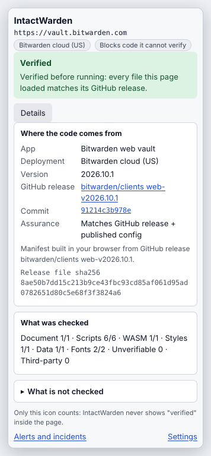
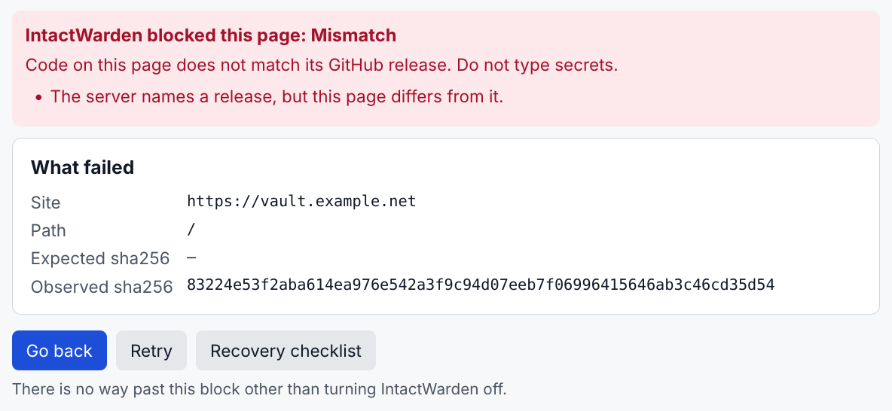
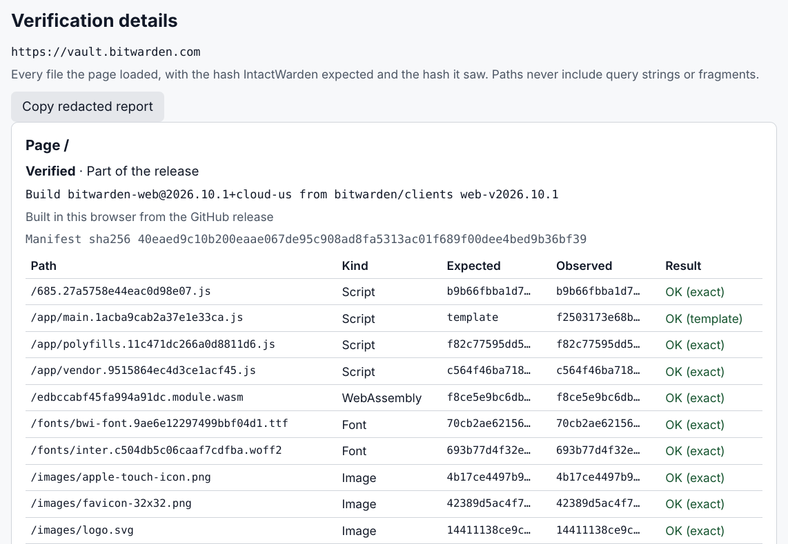

# IntactWarden

[](https://addons.mozilla.org/firefox/addon/intactwarden/)
[](docs/security.md#why-firefox-only)
[](https://github.com/phawrylak/IntactWarden/actions/workflows/ci.yml?query=branch%3Amain)
[](https://github.com/phawrylak/IntactWarden/releases)
[](LICENSE)

**IntactWarden is a Firefox extension that blocks Bitwarden and Vaultwarden web vault code that
does not match the vendor's release on GitHub.**

> [!IMPORTANT]
> Use the Bitwarden and Vaultwarden web vaults only in Firefox with IntactWarden: only Firefox lets
> an extension check code *before* it runs ([why](docs/security.md#why-firefox-only)). IntactWarden
> needs desktop Firefox 153 or newer.

End-to-end encryption in a web app is only as trustworthy as the JavaScript the server sends on each
visit. IntactWarden compares that code byte for byte with the vendor's GitHub release before the
page can use it. **Code that does not match does not run.** Your browser does the whole check;
there is no project server.

**[Get IntactWarden for Firefox](https://addons.mozilla.org/firefox/addon/intactwarden/)** from
addons.mozilla.org (AMO). Version 1.0.0 is published there and as a
[GitHub release](https://github.com/phawrylak/IntactWarden/releases). One person maintains the
project. It is independent: not affiliated with or endorsed by Bitwarden, Inc. or the Vaultwarden
project.

## What it looks like

<table>
<tr>
<td align="center"><br>The vault runs its GitHub release</td>
<td align="center"><br>Code that does not match is blocked</td>
</tr>
</table>

**Details** lists every file the page loaded, with the hash IntactWarden expected and the hash it saw:



## Why I built it

I use Bitwarden Password Manager and Secrets Manager: open source, audited, end-to-end encrypted.
I can check the desktop and mobile apps, but not the web vault: the browser downloads its code from
Bitwarden's servers on every visit, and nothing shows that it is the code published on GitHub. Some operations, such as changing the master password, exist only there. A
server could send modified code that captures the master password, to one person only, and that
person would practically never notice. IntactWarden closes that gap.

IntactWarden is inspired by Meta's [Code Verify](https://github.com/facebookincubator/meta-code-verify),
a browser extension for WhatsApp Web and other Meta sites.

[WEBCAT](https://github.com/freedomofpress/webcat) and [WAICT](https://waict.dev/) can verify web
apps too, but only when the site's operator takes part, and Bitwarden takes part in neither today.
IntactWarden needs nothing from Bitwarden: it checks against the releases already on GitHub. If
Bitwarden or Vaultwarden adopt WEBCAT or WAICT one day, that will be the better long-term answer for
most people.

## What it protects

| App | Where | Checked against |
|---|---|---|
| Bitwarden web vault, including Secrets Manager | `vault.bitwarden.com`, `vault.bitwarden.eu`, self-hosted (official images) | the `bitwarden/clients` `web-v*` release zip; for the cloud, also the configuration published at the release tag |
| Vaultwarden web vault | self-hosted | the `dani-garcia/bw_web_builds` release tarball |

## Install and try

Install IntactWarden from
[addons.mozilla.org](https://addons.mozilla.org/firefox/addon/intactwarden/). The
[user guide](docs/guide.md) explains the rest.

To try your own build instead, build it (Node.js 22.18 or newer) and load it as a temporary add-on:

```sh
git clone https://github.com/phawrylak/IntactWarden.git && cd IntactWarden
npm ci --ignore-scripts
npm run build:ext      # → extension/dist/firefox/
```

In Firefox, open `about:debugging#/runtime/this-firefox`, choose "Load Temporary Add-on…" and select
`extension/dist/firefox/manifest.json`. Firefox removes a temporary add-on when it restarts.

## How it works

- **Hold, hash, release.** Firefox lets IntactWarden hold every page and code file of a protected
  site before the page gets it. A file is released only if its hash is in the list of expected
  hashes (the *manifest*) of the page's build. Redirects and headers that could pull in other code
  are blocked, and a strict Content Security Policy is added.
- **Manifests built in your browser.** The first time a site runs a release, your browser downloads
  it from GitHub, checks it against the checksum GitHub lists and builds the manifest. Nothing from
  the vault's server goes into a manifest.
- **Few ways past.** Code that differs is blocked; only disabling the add-on gets past it. A build
  that no release explains is blocked too, with "Proceed once" for that page. Payment scripts need
  your consent for one page load.
- **Honest states.** The toolbar icon shows each tab's state. Green means the code is the code of
  the GitHub release, not that the release is benign
  ([what it does not prove](docs/guide.md#what-intactwarden-does-not-prove)).

## Why you can trust it

An extension like this runs next to your password vault, so do not take it on faith.

- I publish it under my real name, Paweł Hawrylak: GitHub [@phawrylak](https://github.com/phawrylak),
  LinkedIn [phawrylak](https://www.linkedin.com/in/phawrylak).
- I sign my release tags with my OpenPGP key from
  [keys.openpgp.org](https://keys.openpgp.org/search?q=phawrylak%40outlook.com), also at
  `https://github.com/phawrylak.gpg`.
- There is no external audit. Please review the code yourself, by hand or with an AI assistant:
  give it the repository and [docs/security.md](docs/security.md), and ask how the extension could
  leak data, accept tampered code or raise a false alarm.
- Builds are reproducible, every release zip comes with GitHub build provenance, and from version
  1.0.1 a public workflow compares the package AMO serves with that zip every day
  ([how to check](docs/security.md#check-it-yourself)).
- No third-party code, no remote code, no telemetry. It talks only to the protected sites and GitHub
  ([privacy policy](docs/privacy.md)) and never asks for access to all websites.

## Documentation

- [User guide](docs/guide.md): states, blocked pages, your own server, troubleshooting.
- [Privacy policy](docs/privacy.md).
- [Security model](docs/security.md): what it protects against, what you still trust, how to check
  a release.
- [Release process](docs/release.md) and [CHANGELOG](CHANGELOG.md).

## Development

```sh
npm ci --ignore-scripts
npm run check          # lint, typecheck, unit tests, link check
npm run test:corpus    # rebuild the manifests of the real releases (first run: 92 MB or more)
npm run build:ext      # → extension/dist/firefox/
npm run package:ext    # → extension/dist/intactwarden-<version>-firefox.zip and SHA256SUMS
npm run test:e2e       # end-to-end tests in a real Firefox (Linux x86_64)
```

Behind a proxy, set `NODE_USE_ENV_PROXY=1` (Node 22.21+). [How to run `test:e2e`](extension/test/e2e/README.md).

## Contributing

Issues and pull requests are welcome; for a larger change, please open an issue first. Report
vulnerabilities privately, as [SECURITY.md](SECURITY.md) describes. Before a pull request, run
`npm run check`, add tests for any change to what the extension accepts or shows, and put every
user-visible string in both `extension/_locales/en` and `pl`.

## Licence

[MIT License](LICENSE). Trademarks and third-party material: [NOTICE.md](NOTICE.md).
